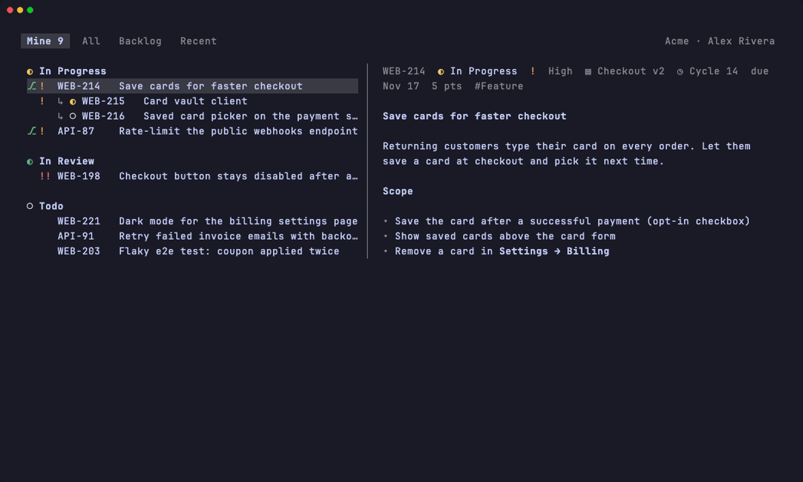
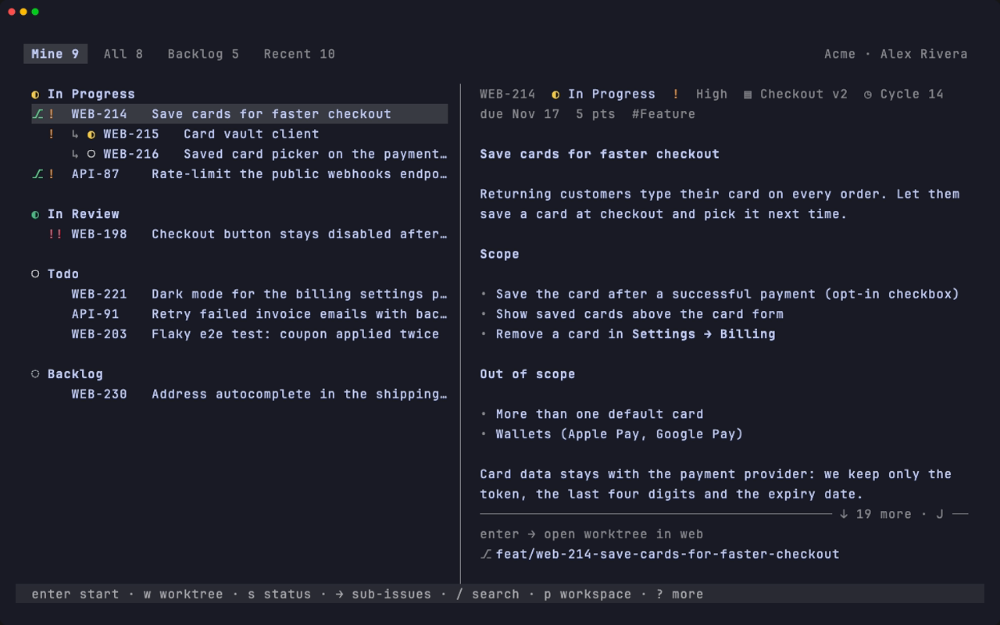
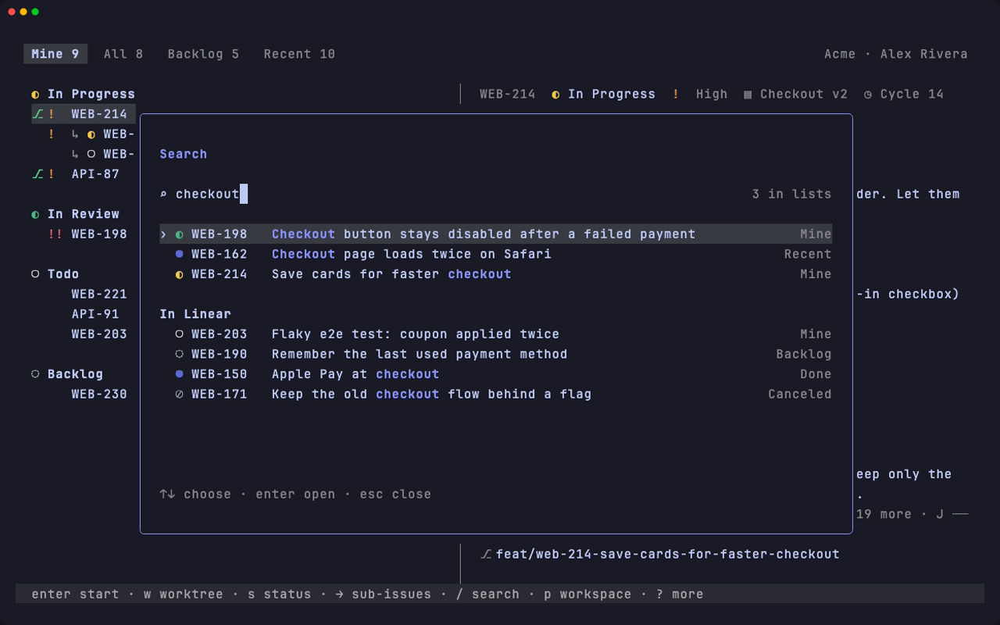
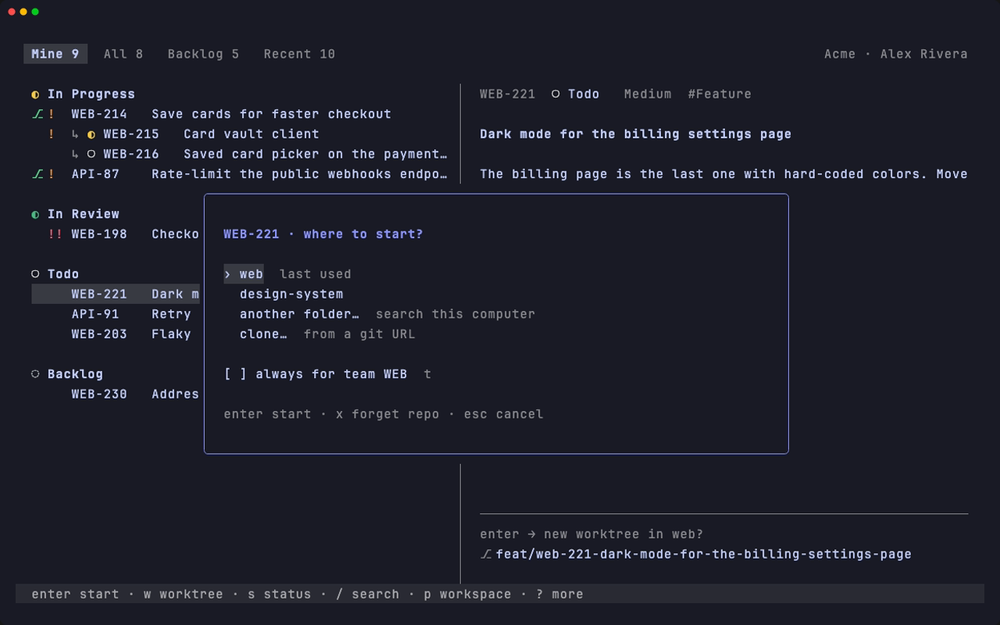
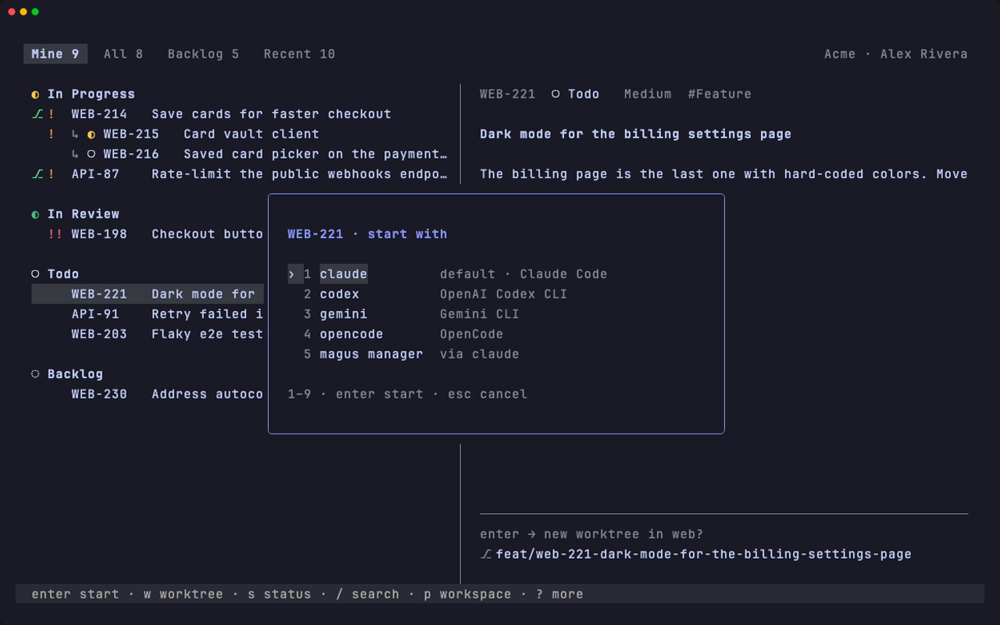
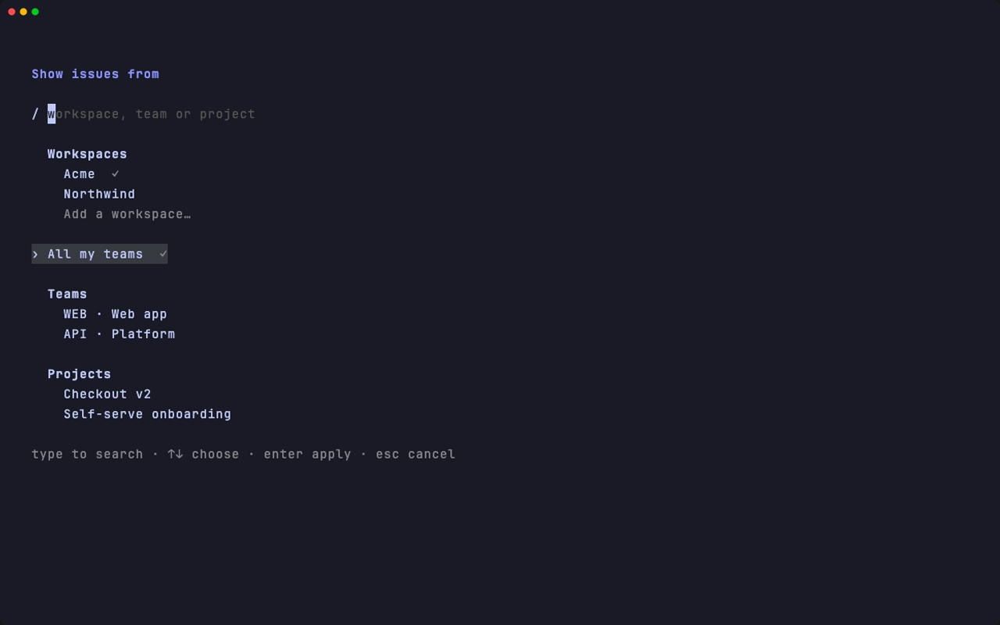
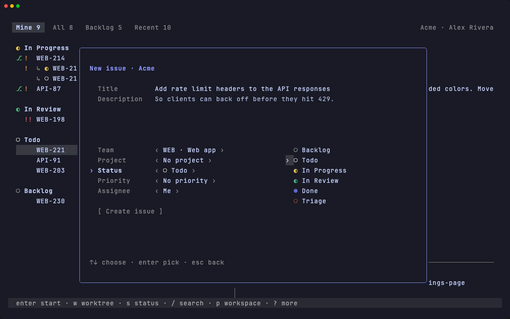

# herdr-linear-kickoff

A [herdr](https://herdr.dev) plugin: pick a Linear issue, and get a worktree on
its branch with a coding agent already started on it — the agent gets the
whole issue (description, comments, parent, sub-issues) as its first prompt, so
there's no "go read ABC-123" step.



<sub>All screenshots are of the [demo mode](#try-it-without-a-key): a made-up
workspace.</sub>

## What it does

- **Lists your Linear issues** in a herdr popup: *Mine*, *All* (active issues,
  anyone's), *Backlog*, *Recent* (what you created, have or follow, changed in
  the last 30 days, closed ones too) — all narrowed to one team or project with
  `p`. The tabs show counts, load in the background, and the popup reopens on
  the last one. Sub-issues sit under their parent; the preview renders the
  description (tables and highlighted code too), cycle, due date, estimate,
  sub-issues, linked pull requests (`g` opens one) and comments, and `→` opens
  a sub-issue.
- **Several Linear workspaces**, one at a time: each with its own key, lists
  and settings. The popup opens on the workspace last used in the repo it's
  opened from; `p` switches and adds them. An ID or link of another
  workspace's issue takes you there.
- **Start (`enter`)**:
  1. picks the repo (see below) and creates a git worktree on the issue's
     branch — or opens the existing one;
  2. moves the issue to *In Progress* and assigns it to you if it's unassigned;
  3. in a new worktree, installs the project's packages (bun / pnpm / yarn / npm,
     by lockfile);
  4. starts the agent (claude, codex, gemini, cursor-agent, opencode, qwen, or
     your own command) with the issue as its prompt — or, with
     [magus](#magus), magus orchestrator's manager.
- **Asks first** before starting an issue that's closed, someone else's or
  already in review.
- **Another agent this time (`A`)**: pick claude, codex, … or magus manager
  for this start only; `enter` keeps using the one in settings.
- **Worktree only (`w`)**: the same repo choice and worktree, and packages in a
  new one — but no agent and no change in Linear; the shell is yours.
- **Search (`/`)**: finds issues in every tab as you type (fuzzy, matches lit),
  then in Linear itself — closed issues, other teams, descriptions. Paste
  `ABC-123` or a `linear.app` link to open that issue; or
  Ctrl+click a Linear link in any terminal pane.
- **New issue (`n`)**: title, description, team, project, status, priority,
  assignee; `enter` on the title or on Create creates it. Team and project start
  as the list's scope, but any can be picked: `enter` or typing on a field opens
  a searchable list beside it. Then
  the issue is selected, and `enter` starts it.
- **Status**: `s` changes it, in Linear's order, with its number keys.
- **Sidebar**: the workspace shows the issue's state and title, kept current.

### Screenshots

**The list.** Sub-issues under their parent, `⎇` marks issues that already
have a worktree; the preview shows the description, sub-issues and comments.



**Search (`/`).** The loaded tabs as you type, then Linear's own search:
closed issues, other teams, descriptions.



**Where to start.** The team's repos first, or any folder on the computer, or
a fresh clone.



**Another agent, this time only (`A`).**



**Workspaces, teams and projects (`p`).** Several Linear workspaces, one at a
time; the list narrowed to a team or a project.



**A new issue (`n`).** Created in the workspace and team you're looking at;
then `enter` starts it.



## Try it without a key

```sh
git clone https://github.com/rshelekhov/herdr-linear-kickoff && cd herdr-linear-kickoff
go run . demo                # or bin/herdr-linear-kickoff demo in an installed copy
```

The popup on two made-up workspaces (Acme: two teams, two projects, a couple
dozen issues; Northwind, smaller): everything works, but nothing goes to Linear or herdr, and a start
only shows what it would do. It runs in a temp folder of its own and doesn't
read your repos, settings or key.

## Install

Needs herdr 0.9.5+ on macOS or Linux, and git.

```sh
herdr plugin install rshelekhov/herdr-linear-kickoff
```

With Go 1.25+ installed, the plugin builds from source; without it, the
release binary for your platform is downloaded and checked against the
release's SHA-256 checksums.

Bind keys in `~/.config/herdr/config.toml`, then `herdr server reload-config`:

```toml
[[keys.command]]
key = "prefix+i"
type = "plugin_action"
command = "rs.linear-kickoff.open"
description = "Linear: issues"

[[keys.command]]
key = "prefix+shift+i"
type = "plugin_action"
command = "rs.linear-kickoff.by-id"
description = "Linear: go to issue"
```

The first time the popup opens it asks for a Linear **personal API key**
(Linear → Settings → Security & access → Personal API keys). It's checked
against Linear and kept in the macOS Keychain / Secret Service, or a `0600` file
when no keyring is available. `LINEAR_API_KEY` in the environment also works.

**More workspaces:** `p` → *Add a workspace…*, and paste a key made in that
workspace (a key belongs to one). `p` lists them to switch; the popup reopens
on the one last used in the repo you open it from. In settings, `x` on the key
removes the workspace.

## Which repo

One Linear team often works in several repos, and which ones an issue touches
often only turns out while working on it. So the repo is picked per issue:

- **No question** when the issue already has a worktree, or the team/project is
  pinned to a repo.
- **Otherwise a short chooser** of the repos picked before for that team, with a
  guess on top and why: the repo's name in the issue's text, the parent issue's
  repo, or the last one used. *another folder…* searches the git repos on this
  machine (`repo_roots` and herdr-navigator's roots) or takes a path.
- ***clone…*** gets one that isn't here yet: a git URL, or `org/repo` (via `gh`
  when installed, so private repos work). Pick the folder from the ones your
  repos are already in — the one matching the URL (`~/github.com`, a folder named
  after the org) or next to the team's other repos comes first — or type a path
  (created if missing). git's progress shows as it goes; `esc` cancels and
  removes the half-done clone.
- In the chooser: `p` / `t` pin for the project / team, `x` forgets a wrong pick.
  `R` in the list opens the chooser even when the repo is pinned.

The preview's last line always says where the worktree will be:
`enter → new worktree in abc_billing?` (`?` — it will ask).

## Keys

| | |
|---|---|
| `↑↓` `j/k` | move |
| `enter` | start the issue |
| `w` | only open / create its worktree |
| `A` | start with another agent, this time |
| `→` / `←` | into the sub-issues / back |
| `tab` `1-4` | Mine / All / Backlog / Recent |
| `p` | workspace, team or project |
| `n` | new issue |
| `g` | open its pull request |
| `/` `:` | search: every tab, then Linear; or an ID / link |
| `s` | change status |
| `R` | choose the repo |
| `J/K` `ctrl+d/u` | scroll the preview |
| `o` / `y` | open in the browser / copy the link |
| `r` | refresh |
| `,` | settings |
| `?` | all the keys (the footer shows the main ones) |
| `q` `esc` | close |

## Settings

`,` opens them:

- **API key** — the current workspace's: replace it, or remove the workspace.
- **Branch name** — presets shown with this issue's branch, or your own template;
  **Ask branch type** when the template has `{type}`.
- **Workspace name** — what herdr calls the issue's workspace: `{ID}`,
  `{ID} {title}`, `{ID} · {title}`, `{title}`, or your own (`{id} {team} {number}` too).
- **Sub-issues** — each on its own branch, or in the parent's worktree.
- **Agent** — the installed ones, or your own command; **Launch** — `prompt` or
  `magus`.
- **Install packages** — `auto` (by lockfile), `none`, or your own command.
- **Set In Progress**, **Assign to me** — what Start changes in Linear.

Changes are saved at once to
`~/.config/herdr/plugins/config/rs.linear-kickoff/config.toml`, comments kept;
`e` opens that file in `$EDITOR` for the rest (prompt template, `repo_roots`,
`clone_root`, `background`, …). It's written with comments on first run.

Branch name placeholders: `{linear}` (Linear's own branch name), `{id}` `{ID}`
`{team}` `{number}` `{slug}` `{type}` (feat/fix/… from labels) `{me}`. Keep
`{id}`, `{ID}` or `{linear}` in it so Linear links the PR to the issue.

The prompt is `prompt_template`, with `{identifier} {title} {url} {branch}
{description} {comments} {parent} {subissues}`.

## magus

With [magus](https://github.com/MadAppGang/magus), set *Launch* to `magus` in
settings (`launch = "magus"`). Start then opens the worktree as usual and runs
`claude "/orchestrator:manager <id> <url>"` in it: magus orchestrator's manager
reads the issue itself, picks `/dev:dev` or `/dev:fix`, and opens child sessions
in other repos when the work needs them.

It needs:

- Claude Code as the agent (`claude` or `claudish`);
- the orchestrator plugin: `claude plugin install orchestrator@magus`
  (it brings its `terminal` dependency);
- a Linear MCP server in Claude Code, which the manager reads the issue through.

Start refuses before creating anything if the agent or the plugin is missing.
The first time Claude Code opens a new worktree it may ask whether to trust the
folder. A triage session is optional: without one, the manager's findings for
triage just aren't routed anywhere.

## Sidebar

Workspaces opened on an issue get `$issue`, `$issue_state` and `$issue_title`.
Show them in herdr's sidebar:

```toml
[ui.sidebar.spaces]
rows = [["state_icon", "workspace", "$issue_state"], [{ token = "$issue_title", dim = true }], ["branch", "git_status"]]
```

They're restored when herdr starts and refreshed from Linear when you switch
workspaces (at most every 5 minutes). `labels = false` turns this off.

## Security

- **The API key** is never written to logs, prompts, or plugin state.
- **Issue text is untrusted.** Anyone who can edit an issue or comment on it
  writes part of the agent's prompt. The plugin strips terminal control
  characters from everything it shows, and wraps issue text in tags with a
  random per-prompt suffix, marked as data rather than instructions — but a
  prompt can't make an agent immune to a persuasive issue. **Don't run the
  agent in an auto-approve / "yolo" mode on issues from people you don't
  trust**, and review what it does before it pushes. Note that some wrappers
  (e.g. `claudish`) auto-approve by default.
- **The magus launch line** carries only the issue's ID and URL, both checked
  against Linear's formats — never its title, which anyone can write.
- **Cloning** passes the URL to git as an argument after `--`, refuses
  option-like URLs and the `ext::` transport, and never waits on a password
  prompt.
- **Network**: `api.linear.app`, `git fetch` / `git clone` (or `gh repo clone`),
  and — when installing without Go — the release download from GitHub.

## Development

```sh
go test ./...
sh scripts/build.sh          # bin/herdr-linear-kickoff
herdr plugin link .          # link doesn't build: run build.sh after changes
sh scripts/screens.sh        # the README images, from the demo (needs vhs)
```

Releases: push a tag `vX.Y.Z` matching `version` in `herdr-plugin.toml`; the
workflow builds the binaries with GoReleaser.

## License

MIT — see [LICENSE](LICENSE).
